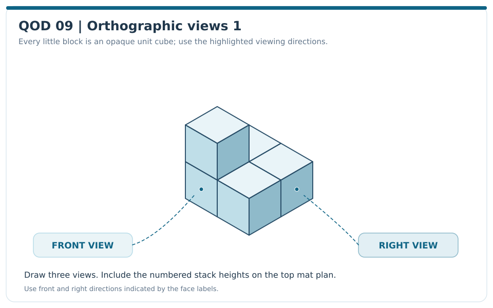
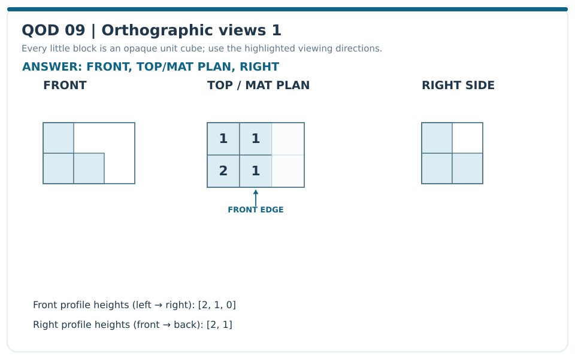

The image shows a new solid built from identical unit cubes. **Draw its front, top, and right-side views.** For the top view, also draw a **mat plan** indicating the height of every occupied stack. Use the explicit **FRONT VIEW** and **RIGHT VIEW** markers beneath the model.

## Solution

> [!example]- Show solution
> The three orthographic views and the numbered mat plan are shown below. Looking left-to-right, the front profile has heights **[2, 1, 0]**; looking from front to back, the right-side profile has heights **[2, 1]**. The top/mat plan is **[2, 1, 0]; [1, 1, 0]** (rows run front to back).
>
> 

> [!abstract] Review First
> _No linked questions yet._

<!-- QOD-RELATIONSHIP-SEPARATOR -->

> [!info] Explore Also
> - [[Math/Geometry/Orthographic Views 2 - Unit Cube Model|Orthographic Views 2 - Unit Cube Model]]
> - [[Math/Geometry/Surface Area and Volume - From Net to Surface Area|Surface Area and Volume - From Net to Surface Area]]

<!-- QOD-RELATIONSHIP-SEPARATOR -->

> [!success] Build Toward
> - [[Math/Geometry/Isometric Drawings 1 - Reconstructing a Solid|Isometric Drawings 1 - Reconstructing a Solid]]
> - [[Math/Geometry/Isometric Drawings 2 - Reconstructing a Solid|Isometric Drawings 2 - Reconstructing a Solid]]
> - [[Math/Geometry/Isometric Drawings 3 - Reconstructing a Solid|Isometric Drawings 3 - Reconstructing a Solid]]
> - [[Math/Geometry/Isometric Drawings 4 - Reconstructing a Solid|Isometric Drawings 4 - Reconstructing a Solid]]
> - [[Math/Geometry/Isometric Drawings 5 - Reconstructing a Solid|Isometric Drawings 5 - Reconstructing a Solid]]
> - [[Math/Geometry/Isometric Drawings 6 - Reconstructing a Solid|Isometric Drawings 6 - Reconstructing a Solid]]
> - [[Math/Geometry/Orthographic Views 2 - Unit Cube Model|Orthographic Views 2 - Unit Cube Model]]
> - [[Math/Geometry/Orthographic Views 3 - Unit Cube Model|Orthographic Views 3 - Unit Cube Model]]
> - [[Math/Geometry/Orthographic Views 4 - Unit Cube Model|Orthographic Views 4 - Unit Cube Model]]
> - [[Math/Geometry/Orthographic Views 5 - Unit Cube Model|Orthographic Views 5 - Unit Cube Model]]
> - [[Math/Geometry/Orthographic Views 6 - Unit Cube Model|Orthographic Views 6 - Unit Cube Model]]
> - [[Math/Geometry/Orthographic Views 7 - Unit Cube Model|Orthographic Views 7 - Unit Cube Model]]
> - [[Math/Geometry/Orthographic Views 8 - Unit Cube Model|Orthographic Views 8 - Unit Cube Model]]
> - [[Math/Geometry/Perspective Drawings 1 - One-Point Prism|Perspective Drawings 1 - One-Point Prism]]
