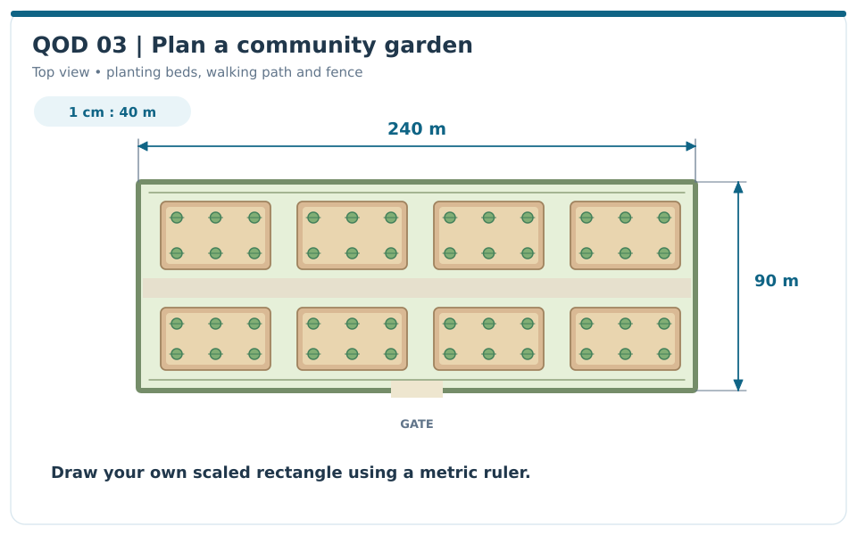
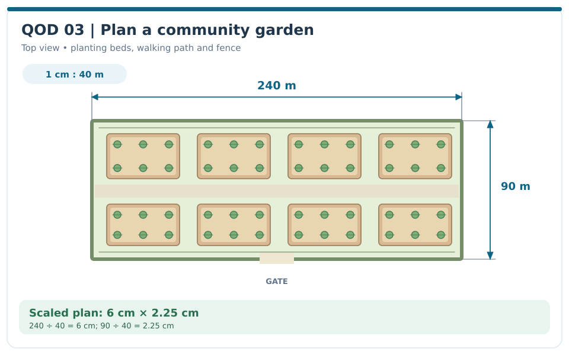

A community garden is rectangular, measuring **240 m by 90 m**. Draw a scale plan using **1 cm : 40 m**. State the dimensions your drawing must have.

## Solution

> [!example]- Show solution
> $$240\div40=6\text{ cm},\qquad90\div40=2.25\text{ cm}.$$ Draw a $6\text{ cm}\times2.25\text{ cm}$ rectangle with a ruler.
>
> 

> [!abstract] Review First
> - [[Math/Proportional Reasoning/Scale Drawings 1 - Classifying Enlargements and Reductions|Scale Drawings 1 - Classifying Enlargements and Reductions]]
> - [[Math/Proportional Reasoning/Scale Factors 1|Scale Factors 1]]

<!-- QOD-RELATIONSHIP-SEPARATOR -->

> [!info] Explore Also
> - [[Math/Proportional Reasoning/Area Scale Factors 2|Area Scale Factors 2]]
> - [[Math/Proportional Reasoning/Scale Drawings 4 - Outdoor Exhibit|Scale Drawings 4 - Outdoor Exhibit]]
> - [[Math/Proportional Reasoning/Scale Drawings 6 - Park Map Distance|Scale Drawings 6 - Park Map Distance]]

<!-- QOD-RELATIONSHIP-SEPARATOR -->

> [!success] Build Toward
> - [[Math/Proportional Reasoning/Scale Drawings 4 - Outdoor Exhibit|Scale Drawings 4 - Outdoor Exhibit]]
