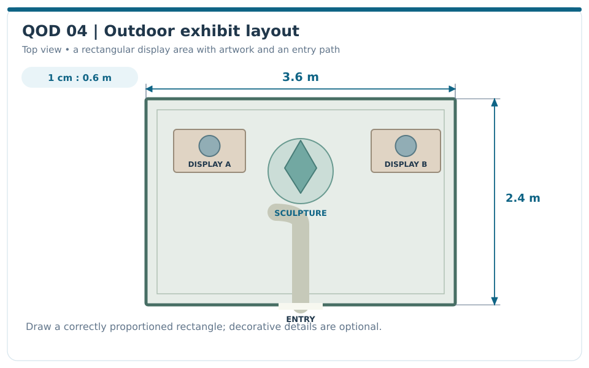
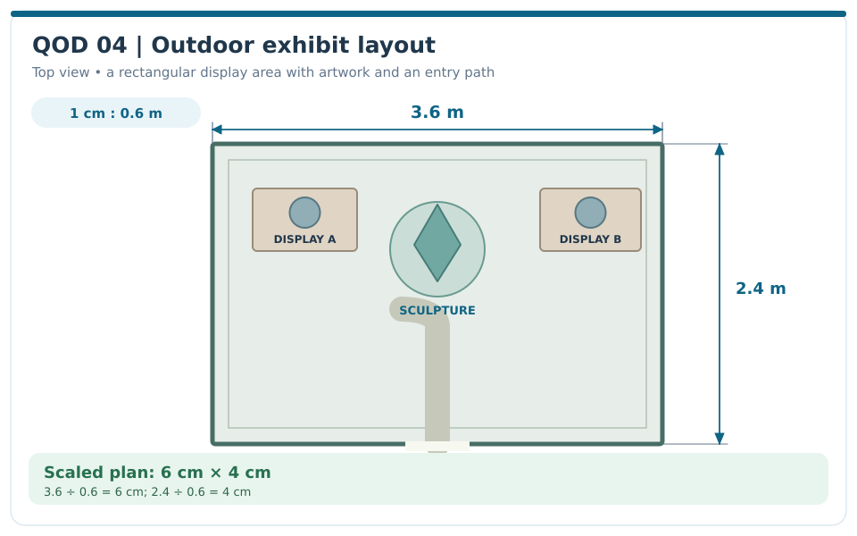

An outdoor exhibit measures **3.6 m by 2.4 m**. Sketch a scaled rectangle using **1 cm : 0.6 m**. Label the scaled lengths.

## Solution

> [!example]- Show solution
> $$3.6\div0.6=6\text{ cm},\qquad2.4\div0.6=4\text{ cm}.$$ The plan is $6\text{ cm}\times4\text{ cm}$.
>
> 

> [!abstract] Review First
> - [[Math/Proportional Reasoning/Scale Drawings 1 - Classifying Enlargements and Reductions|Scale Drawings 1 - Classifying Enlargements and Reductions]]
> - [[Math/Proportional Reasoning/Scale Drawings 3 - Community Garden Plan|Scale Drawings 3 - Community Garden Plan]]
> - [[Math/Proportional Reasoning/Scale Factors 1|Scale Factors 1]]

<!-- QOD-RELATIONSHIP-SEPARATOR -->

> [!info] Explore Also
> - [[Math/Proportional Reasoning/Area Scale Factors 2|Area Scale Factors 2]]
> - [[Math/Proportional Reasoning/Scale Drawings 3 - Community Garden Plan|Scale Drawings 3 - Community Garden Plan]]
> - [[Math/Proportional Reasoning/Scale Drawings 8 - Resizing a Banner|Scale Drawings 8 - Resizing a Banner]]

<!-- QOD-RELATIONSHIP-SEPARATOR -->

> [!success] Build Toward
> _No linked questions yet._
