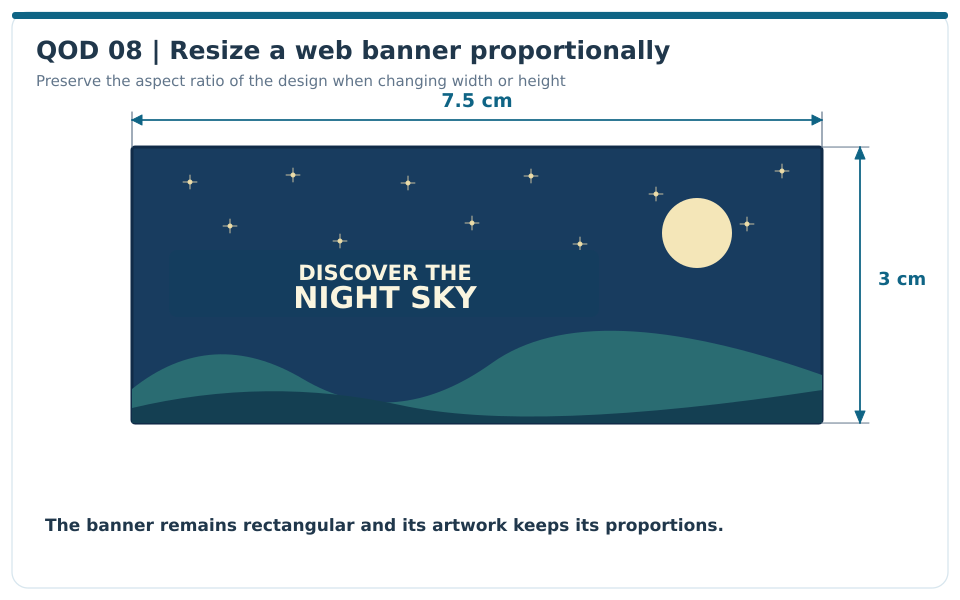
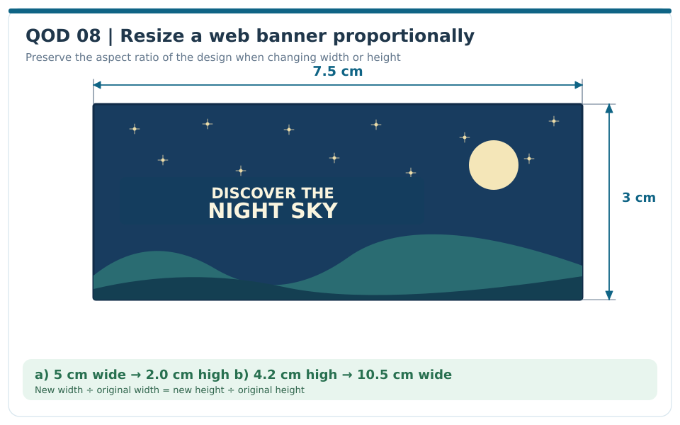

A web banner measures **7.5 cm wide and 3 cm high** in a printed proof. **(a)** If the new width is 5 cm, what height preserves the proportions? **(b)** If the height becomes 4.2 cm, what width is needed?

## Solution

> [!example]- Show solution
> a) $$3\times\frac{5}{7.5}=2\text{ cm}.$$ b) $$7.5\times\frac{4.2}{3}=10.5\text{ cm}.$$
>
> 

> [!abstract] Review First
> - [[Math/Proportional Reasoning/Scale Drawings 1 - Classifying Enlargements and Reductions|Scale Drawings 1 - Classifying Enlargements and Reductions]]
> - [[Math/Proportional Reasoning/Scale Factors 1|Scale Factors 1]]

<!-- QOD-RELATIONSHIP-SEPARATOR -->

> [!info] Explore Also
> - [[Math/Proportional Reasoning/Scale Drawings 4 - Outdoor Exhibit|Scale Drawings 4 - Outdoor Exhibit]]

<!-- QOD-RELATIONSHIP-SEPARATOR -->

> [!success] Build Toward
> - [[Math/Proportional Reasoning/Area Scale Factors 1|Area Scale Factors 1]]
> - [[Math/Proportional Reasoning/Scale Factors 2|Scale Factors 2]]
> - [[Math/Proportional Reasoning/Volume Scale Factors 1|Volume Scale Factors 1]]
